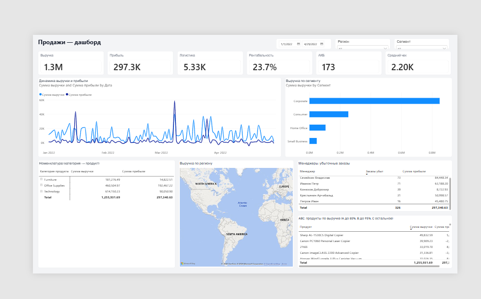

# Sales dashboard (Power BI)

One-page sales report: web-sourced fact table, DAX KPIs, and standard analytics visuals (trend, segment, product drill-down, map, ABC, manager losses).

**Author:** [David-saytrue](https://github.com/David-saytrue) · Tbilisi, Georgia

**File:** [`sales-dashboard-en.pbix`](sales-dashboard-en.pbix)  
Open in **Power BI Desktop**. First open: **File → Options → Global → Security → Use Map and filled map visuals**.

Related prep repo: [data-engineer-prep](https://github.com/David-saytrue/data-engineer-prep)



## What it shows

| Visual | Question it answers |
|--------|---------------------|
| 6 KPI cards | Revenue, profit, logistics cost, profitability, active customers, average order value |
| Line chart | Revenue and profit over time |
| Bar chart | Revenue by customer segment |
| Matrix | Product hierarchy: category → subcategory → product |
| Filled map | Revenue by region |
| Manager table | Loss-making order count and profit by manager |
| ABC table | Products ranked by revenue (Pareto: A ≤80%, B ≤95%, C rest) |
| Slicers | Date, region, segment |

## Model

Source is a Google Sheet workbook loaded with `Web.Contents` (not a local Excel file). Power Query flattens lookups into one **Sales** table.

Workbook tab IDs are fixed on the source file. After load, columns are renamed to English:

| Sales column | Role |
|--------------|------|
| `Order_ID` | Order grain |
| `Date` | Time axis (from Dates lookup) |
| `Product`, `Category`, `Subcategory` | Product hierarchy |
| `Customer`, `Segment` | Customer |
| `Region`, `Manager` | Geography / owner (manager joins on **region**) |
| `ShipMethod`, `ShippingCost` | Logistics |
| `Revenue`, `Profit`, `Quantity` | Facts |

Blank `Order_ID` rows are dropped. Lookup queries are **Enable load OFF**; only **Sales** loads into the model.

M scripts (English query names):

| File | Power Query name |
|------|------------------|
| `queries/Sales.m` | Sales |
| `queries/Dates.m` | Dates |
| `queries/Products.m` | Products |
| `queries/Customers.m` | Customers |
| `queries/Managers.m` | Managers |
| `queries/Shipping.m` | Shipping |
| `queries/ABC-Products.m` | ABC_Products (optional) |

## DAX

Measures live on **Sales**. Names differ from columns so Power BI does not reject them.

```dax
Total Revenue = SUM('Sales'[Revenue])
Total Profit = SUM('Sales'[Profit])
Logistics Cost = SUM('Sales'[ShippingCost])
Profitability = DIVIDE([Total Profit], [Total Revenue], 0)   -- format %
Active Customers = DISTINCTCOUNT('Sales'[Customer])
Avg Order Value = DIVIDE([Total Revenue], DISTINCTCOUNT('Sales'[Order_ID]), 0)
Loss Making Orders =
CALCULATE(
    DISTINCTCOUNT('Sales'[Order_ID]),
    'Sales'[Profit] < 0
)
```

Full copy-paste: [`dax-measures.dax`](dax-measures.dax).

**Why these definitions**

- Profitability is a ratio, not a sum.
- Active customers is distinct buyers, not rows.
- Average order value is per **order**, not per line.
- Loss-making orders use `CALCULATE` + `Profit < 0`.
- Managers join on **region**, not customer.

## Rebuild notes

1. Paste each `queries/*.m` into Power Query Advanced Editor (names in the table above).
2. Close & Apply.
3. Recreate the 7 measures (or run `scripts/Create-All-Measures.csx` in Tabular Editor).
4. Optional ABC class column: `queries/ABC-Products.m` with Enable load ON.

The checked-in `.pbix` is the working report. A full rebuild from these scripts produces English table and column names.

## Portfolio note

This is a compact analytics case (course-style Superstore data), not a production semantic model. It shows web ingest, Power Query joins, reusable DAX, and a readable one-page report.
